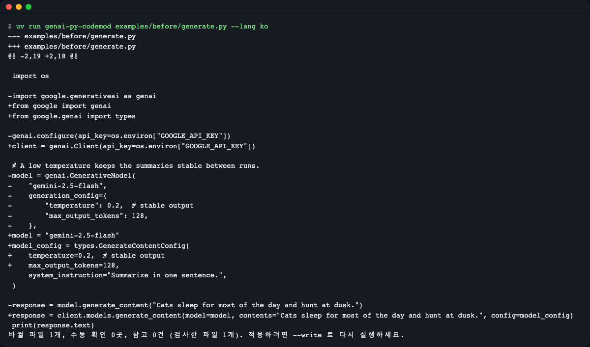
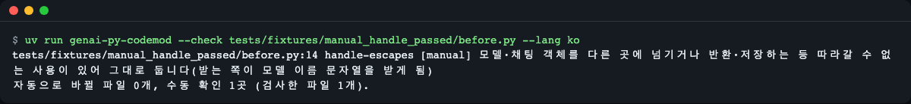
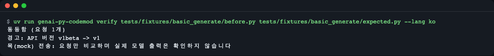
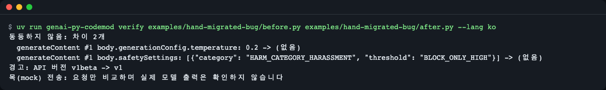
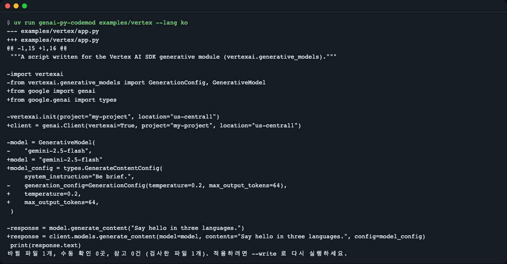
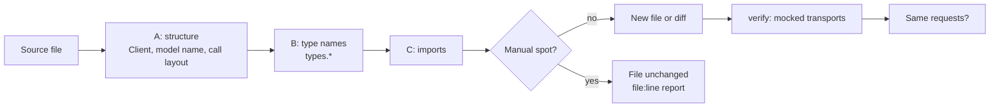

# genai-py-codemod

[English](README.md) | **한국어**

`google-generativeai` 또는 `vertexai.generative_models` 로 쓴 Python 코드를 `google-genai` SDK 로 옮겨 주는 코드 변환 도구입니다. 주석과 서식은 그대로 두고([libcst](https://github.com/Instagram/LibCST)로 구문 트리를 고칩니다), 건드리지 않은 곳은 목록으로 알려 주며, `verify` 명령으로 옛 코드와 새 코드가 같은 API 요청을 보내는지 API 키·네트워크 없이 확인합니다.


*`examples/before/generate.py` 를 시험 실행한 결과: `genai.configure` 와 `GenerativeModel` 이 `genai.Client` 와 `generate_content(model=..., config=...)` 로 바뀌고 `# stable output` 주석은 그대로입니다.*

## 이런 분께

- 아직 `import google.generativeai as genai` 를 쓰는 스크립트·서비스를 관리합니다. 이 패키지의 지원은 2025-11-30 에 끝났습니다([이전 가이드](https://ai.google.dev/gemini-api/docs/migrate)).
- `vertexai.generative_models`(`GenerativeModel`, `GenerationConfig`)를 쓰고 있고 `google-genai` 의 Vertex 모드로 옮겨야 합니다.
- 먼저 검토할 diff, 사람이 봐야 할 곳의 목록, 옮긴 파일이 같은 요청을 보낸다는 근거가 필요합니다.

## 설치

Python 3.11 이상이 필요합니다. PyPI 패키지 이름은 `genai-py-codemod` 입니다(첫 릴리스와 함께 게시). 최소 리눅스 이미지에서는 `curl`, 그리고 clone 방법에는 `git` 도 필요합니다.

**내 프로젝트에 쓰기** (변환만, `libcst` 만 필요):

```bash
curl -LsSf https://astral.sh/uv/install.sh | sh   # uv 설치(uvx 포함)
uvx genai-py-codemod src/                          # diff 만 출력, 아무것도 바꾸지 않음
# 또는: pipx install genai-py-codemod   /   pip install genai-py-codemod
```

**`verify` 도 쓰기** (파일을 두 SDK 로 각각 실행하므로 실행하는 인터프리터에 두 SDK 가 모두 있어야 합니다):

```bash
uvx --from 'genai-py-codemod[verify]' genai-py-codemod verify old/app.py src/app.py
# 또는: pip install 'genai-py-codemod[verify]'
# 또는: 도구는 그대로 두고 --old-python / --new-python 으로 SDK 가 든 인터프리터를 지정
```

`[verify]` extra 는 `google-generativeai` 와 `google-genai` 를 설치합니다. 없으면 `verify` 는 `ModuleNotFoundError: No module named 'requests'` 로 멈추고, 이어서 무엇을 설치할지 안내합니다.

**들어 있는 예제로 해 보기** (레포 clone):

```bash
git clone https://github.com/LeeGyeongPil/genai-py-codemod
cd genai-py-codemod
uv sync
uv run genai-py-codemod --version
```

```text
genai-py-codemod 0.1.0
```

`uv sync` 는 `verify` 가 쓰는 `google-generativeai`, `google-genai` 도 프로젝트 환경에 설치합니다. 아래 명령은 이 clone 에서 `uv run genai-py-codemod` 로 실행합니다.

## 빠르게 시작하기

들어 있는 예제로 실행해 봅니다. 기본은 diff 만 출력하고 아무것도 바꾸지 않습니다.

```bash
uv run genai-py-codemod examples/before/generate.py --lang ko
```

```diff
--- examples/before/generate.py
+++ examples/before/generate.py
@@ -2,19 +2,18 @@
 
 import os
 
-import google.generativeai as genai
+from google import genai
+from google.genai import types
 
-genai.configure(api_key=os.environ["GOOGLE_API_KEY"])
+client = genai.Client(api_key=os.environ["GOOGLE_API_KEY"])
 
 # A low temperature keeps the summaries stable between runs.
-model = genai.GenerativeModel(
-    "gemini-2.5-flash",
-    generation_config={
-        "temperature": 0.2,  # stable output
-        "max_output_tokens": 128,
-    },
+model = "gemini-2.5-flash"
+model_config = types.GenerateContentConfig(
+    temperature=0.2,  # stable output
+    max_output_tokens=128,
     system_instruction="Summarize in one sentence.",
 )
 
-response = model.generate_content("Cats sleep for most of the day and hunt at dusk.")
+response = client.models.generate_content(model=model, contents="Cats sleep for most of the day and hunt at dusk.", config=model_config)
 print(response.text)
바뀔 파일 1개, 수동 확인 0곳, 참고 0건 (검사한 파일 1개). 적용하려면 --write 로 다시 실행하세요.
```

읽는 법: `-` 로 시작하는 줄은 지워지고 `+` 는 추가됩니다. 마지막 줄이 요약입니다. 새 SDK 에는 모델 객체가 없어서, 모델은 이름 문자열이 되고 설정은 모든 호출이 받는 `types.GenerateContentConfig` 하나로 모입니다.

`--write` 로 적용합니다. 먼저 복사본에서 해 보세요.

```bash
mkdir -p /tmp/try && cp examples/before/generate.py /tmp/try/
uv run genai-py-codemod /tmp/try --write --lang ko
uv run genai-py-codemod /tmp/try --lang ko
```

두 번째 실행은 "바뀔 파일 0개" 라고 나옵니다. 결과가 안정적이라는 뜻입니다.

## 사용법

| 명령·옵션 | 하는 일 | 예 |
|---|---|---|
| `PATH...` | 파일·디렉터리(`*.py`, 재귀)의 diff 를 출력합니다. 파일은 쓰지 않습니다. | `genai-py-codemod src/` |
| `--write` | 옮긴 파일을 씁니다. | `genai-py-codemod src/ --write` |
| `--check` | diff 없이, 바뀔 파일이나 수동 확인 지점이 있으면 종료 코드 1(CI 용). | `genai-py-codemod --check src/` |
| `--report json` | 기계가 읽는 보고서: 요약과 파일별 지점(줄·열·코드·심각도). | `genai-py-codemod src/ --report json` |
| `--api-version auto\|keep\|none` | `auto` 는 `-latest`/`-preview`/`-exp` 모델에만 `v1beta` 를 고정, `keep` 은 옛 SDK 버전을 항상 고정, `none` 은 고정하지 않음. | `--api-version keep` |
| `--lang en\|ko` | 메시지 언어. | `--lang ko` |
| `verify BEFORE AFTER` | 두 파일을 목(mock) 전송으로 실행해 API 요청을 비교합니다. 종료 코드 0 = 같음, 1 = 다름, 2 = 실행 못 함 또는 비교할 요청 없음. | 아래 참고 |

### 시나리오 1: 추측하지 않는 곳

```bash
uv run genai-py-codemod --check tests/fixtures/manual_handle_passed/before.py --lang ko
```

```text
tests/fixtures/manual_handle_passed/before.py:14 handle-escapes [manual] 모델·채팅 객체를 다른 곳에 넘기거나 반환·저장하는 등 따라갈 수 없는 사용이 있어 그대로 둡니다(받는 쪽이 모델 이름 문자열을 받게 됨)
자동으로 바뀔 파일 0개, 수동 확인 1곳 (검사한 파일 1개).
```

(종료 코드 1). 이 파일은 모델을 함수에 넘깁니다(`ask(model, "Hi")`). 옮기면 `model` 이 문자열이 되어 그 함수가 깨집니다. 원칙은 **한 파일은 전부 옮기거나 전혀 안 옮긴다** 입니다. 수동 지점이 하나라도 있으면 파일 전체를 그대로 두고 `파일:줄`, 사유 코드, 설명을 알려 줍니다. 심각도 `info` 인 참고 사항(예: "응답 구조가 바뀜")은 변환을 막지 않습니다.


*모델 객체를 넘기는 파일의 보고: 원본은 그대로이고 해당 줄이 표시됩니다.*

### 시나리오 2: 옮긴 파일이 같은 요청을 보내는지 증명

```bash
uv run genai-py-codemod verify tests/fixtures/basic_generate/before.py tests/fixtures/basic_generate/expected.py --lang ko
```

```text
동등함 (요청 1개)
경고: API 버전 v1beta -> v1
목(mock) 전송: 요청만 비교하며 실제 모델 출력은 확인하지 않습니다
```

`verify` 는 두 SDK 의 실제 요청 생성 코드를 그대로 돌리되 전송 계층만 가짜로 바꿔, 각 SDK 가 보낼 HTTP 요청을 그대로 잡습니다. 네트워크 시도는 막고 횟수를 셉니다. 해롭지 않은 차이로 알려진 것을 정규화한 뒤 두 요청 목록을 비교합니다. API 버전 차이는 경고입니다(`--strict-version` 이면 실패).

요청을 하나도 보내지 않는 스크립트(예: 함수만 정의한 모듈)는 비교한 것이 없으므로 "동등함" 이 아닙니다. `verify` 는 그렇게 알리고 종료 코드 2 로 끝납니다.

```text
비교할 요청이 없습니다: 두 파일 모두 API 요청을 보내지 않았습니다. 끝까지 실행되며 API 를 호출하는 진입점 스크립트를 넘겨 주세요(함수만 정의한 모듈은 아무것도 보내지 않습니다). 맨 아래에 작은 호출을 넣거나 그 모듈을 쓰는 스크립트를 검증하세요.
목(mock) 전송: 요청만 비교하며 실제 모델 출력은 확인하지 않습니다
```


*같은 요청: 종료 코드 0.*

### 시나리오 3: 손으로 옮기다 빠뜨린 설정 찾기

`examples/hand-migrated-bug/` 에는 스크립트와, 맞아 보이지만 설정 두 개를 빠뜨린 손 변환본이 있습니다.

```bash
uv run genai-py-codemod verify examples/hand-migrated-bug/before.py examples/hand-migrated-bug/after.py --lang ko
```

```text
동등하지 않음: 차이 2개
  generateContent #1 body.generationConfig.temperature: 0.2 -> (없음)
  generateContent #1 body.safetySettings: [{"category": "HARM_CATEGORY_HARASSMENT", "threshold": "BLOCK_ONLY_HIGH"}] -> (없음)
경고: API 버전 v1beta -> v1
목(mock) 전송: 요청만 비교하며 실제 모델 출력은 확인하지 않습니다
```

(종료 코드 1). 각 줄은 `요청, JSON 본문 경로: 옛 값 -> 새 값` 입니다.


*새 요청에 temperature 와 안전 설정이 없습니다.*

### 시나리오 4: Vertex AI 코드

```bash
uv run genai-py-codemod examples/vertex --lang ko
```

`vertexai.init(project=..., location=...)` 는 `genai.Client(vertexai=True, project=..., location=...)` 가 되고, `GenerationConfig(...)` 는 `types.GenerateContentConfig(...)` 로 합쳐집니다.


*Vertex AI 코드가 `genai.Client(vertexai=True, ...)` 로 바뀐 모습.*

Vertex 코드를 검증하려면 `google-genai<3` 을 고정한 옛 Vertex SDK 가 필요해 별도 환경을 씁니다. 만들고 `verify` 에 알려 주세요.

```bash
uv run python scripts/make_vertex_env.py
uv run genai-py-codemod verify tests/fixtures/vertex_basic/before.py tests/fixtures/vertex_basic/expected.py --old-python .venv-vertex/bin/python --lang ko
```

```text
동등함 (요청 1개)
경고: API 버전 v1 -> v1beta1
목(mock) 전송: 요청만 비교하며 실제 모델 출력은 확인하지 않습니다
```

### Python 에서

```python
from genai_py_codemod import migrate_source, verify_files

result = migrate_source(open("app.py").read(), path="app.py")
print(result.code)       # 옮긴 소스. 수동 지점이 있으면 입력 그대로
print(result.findings)   # 심각도 "manual" 또는 "info" 인 지점

check = verify_files("old/app.py", "src/app.py")   # 환경이 둘이면 old_python=..., new_python=...
print(check.equivalent)      # 두 쪽 모두 요청을 보냈고 전부 같을 때만 True
print(check.diffs)           # 차이마다 항목 하나(요청, JSON 경로, 옛 값, 새 값)
print(check.nothing_compared)  # 두 파일 모두 요청을 보내지 않았으면 True
```

`verify_files` 는 파일을 실행하지 못하면(죽음, 시간 초과, SDK 없음) `VerifyRunError` 를 냅니다. 그 `code` 는 `missing-file`, `interpreter-not-found`, `timeout`, `no-result`, `script-exit`, `script-failed`, `sdk-missing`, `network-blocked` 중 하나이고, `str(error)` 와 `error.message()` 는 영어 문장을 돌려줍니다. `check.version_changes` 는 API 버전 변경을 쌍으로 담습니다(예: `[('v1beta', 'v1')]`). `check.warnings` 는 같은 내용을 영어 문장(`'API version v1beta -> v1'`)으로 담습니다.

`verify --json` 에서 실행을 끝내지 못하면 `{"equivalent": null, "error": "<코드>", "message": "<고른 언어의 문장>"}` 를 출력하고 종료 코드 2 로 끝납니다. 예: `--lang ko` 이면 `"message"` 가 한국어 문장입니다. 정상 실행의 JSON 에는 `"version_changes": [{"before": "v1beta", "after": "v1"}]` 도 들어 있습니다.

## 무엇이 바뀌나

아래는 코드를 안전하게 따라갈 수 있을 때 도구가 다시 쓰는 규칙입니다. `google.generativeai`(개발자 API)에 적용되며, 표시한 곳은 `vertexai.generative_models`(Vertex AI)에도 적용됩니다.

| 옛 코드 | 새 코드 |
|---|---|
| `import google.generativeai as genai` | `from google import genai` (필요하면 `from google.genai import types` 도) |
| `genai.configure(api_key=K)` | `client = genai.Client(api_key=K)` |
| `vertexai.init(project=P, location=L)` (Vertex) | `client = genai.Client(vertexai=True, project=P, location=L)` |
| `m = genai.GenerativeModel("name", generation_config=..., safety_settings=..., system_instruction=..., tools=...)` | `m = "name"` 와 `m_config = types.GenerateContentConfig(...)` |
| `generation_config={...}` / `GenerationConfig(...)` (두 SDK 모두) | `types.GenerateContentConfig(...)` 의 필드 |
| `{HarmCategory.X: HarmBlockThreshold.Y}` 안전 설정 dict | `safety_settings=[types.SafetySetting(category=..., threshold=...)]` |
| `m.generate_content(x)` | `client.models.generate_content(model=m, contents=x, config=m_config)` |
| `m.generate_content(x, stream=True)` | `client.models.generate_content_stream(...)` |
| `await m.generate_content_async(x)` | `await client.aio.models.generate_content(...)` (변환만, 검증은 안 함) |
| `m.start_chat(history=[...])`, `chat.send_message(x)` | `client.chats.create(model=m, config=m_config, history=[...])`; `stream=True` 는 `send_message_stream` |
| `m.count_tokens(x)` (system instruction·tools 가 없는 모델) | `client.models.count_tokens(model=m, contents=x)` |
| `genai.embed_content(model=..., content=...)` | `client.models.embed_content(...)`, `task_type` 은 대문자로. 결과는 `.embeddings[i].values` 로 읽음(`info` 로 알림) |
| `tools="code_execution"` | `tools=[types.Tool(code_execution=types.ToolCodeExecution())]` |
| `tools="google_search_retrieval"` | `types.GoogleSearchRetrieval` (요청을 똑같이 유지. `"google_search"` 는 `types.GoogleSearch`) |

주석, 빈 줄, 따옴표, 여러 줄 배치는 그대로 둡니다. 도구가 만든 결과에 다시 실행하면 바뀌는 것이 없습니다.

## 사람이 할 일

도구가 안전하게 따라갈 수 없는 곳은 `파일:줄 코드 [심각도] 설명` 으로 알리고 **파일 전체를 그대로 둡니다**. 코드는 다음과 같습니다(JSON 보고서의 `code` 필드와 같습니다).

| 코드 | 심각도 | 이유 | 할 일 |
|---|---|---|---|
| `handle-escapes` | manual | 모델·채팅 객체를 넘기거나 반환·저장함 | 모델 이름 문자열을 넘기도록 바꾸고 다시 실행 |
| `handle-reassigned` | manual | 변수에 여러 번 대입함 | 모델마다 변수 하나 사용 |
| `handle-untracked` | manual | 모델 객체를 일반 변수에 담지 않거나 바로 쓰지 않음 | 먼저 변수에 담기 |
| `call-kwargs` | manual | `*args`, `**kwargs` 를 넘김 | 인자를 풀어 쓰기 |
| `call-args` | manual | `google-genai` 에 대응하는 인자가 없음 | [가이드](https://ai.google.dev/gemini-api/docs/migrate)를 보고 직접 옮기기 |
| `call-config-merge` | manual | 생성 설정이 모델과 호출 양쪽에 있음 | 하나의 dict 로 합치기 |
| `config-dynamic` | manual | 설정이 리터럴 dict 나 `GenerationConfig(...)` 가 아님 | 그 자리에서 만들기 |
| `callable-tools-afc` | manual | `tools` 에 Python 함수가 있고 새 SDK 는 기본으로 자동 호출함 | `automatic_function_calling` 을 직접 정하기 |
| `tools-unsupported` | manual | 변환하지 않는 도구 | 직접 옮기기 |
| `tool-config` | manual | `tool_config` 는 자동 변환이 없음 | 직접 옮기기 |
| `count-tokens-semantics` | manual | system instruction·tools 가 있는 모델의 `count_tokens` 는 세는 방식이 다름 | 무엇을 셀지 정하기 |
| `async-chat` | manual | `send_message_async` | `client.aio.chats` 사용 |
| `history-format` | manual | 채팅 history 가 dict 리터럴 목록이 아님. 새 SDK 는 `{"text": ...}` parts 필요 | history 형식 고치기 |
| `files-api`, `caches-api`, `tuning-api`, `unsupported-api` | manual | 자동 변환이 없는 API(파일 전체를 보류) | 그 호출을 직접 옮기기 |
| `configure-args` | manual | `configure()` / `vertexai.init()` 에 `Client` 가 이어받지 않는 인자가 있음 | 직접 옮기기 |
| `configure-scope` | manual | 모듈 최상위의 문장 하나가 아님 | 최상위로 옮기기 |
| `mixed-sdk` | manual | 한 파일에서 개발자 API 와 Vertex AI SDK 를 함께 씀 | 파일 나누기 |
| `import-scope` | manual | 옛 import 가 최상위에 있지 않음 | import 를 위로 옮기기 |
| `legacy-api` | manual | 변환 뒤에도 옛 SDK 호출이 남음 | 그 호출을 직접 옮기기 |
| `response-shape` | info | 변환했지만 응답이 바뀜(예: 임베딩) | 응답을 읽는 코드 고치기 |
| `dynamic-model` | info | 모델 이름이 문자열 리터럴이 아니라 그대로 옮김 | 유효한 `google-genai` 모델 이름인지 확인 |

`info` 는 변환을 막지 않습니다.

## API 버전

`google-generativeai` 는 `v1beta`(개발자 API) 또는 `v1`(Vertex)로 통신하고 `google-genai` 3.x 는 기본값이 달라서, 같은 호출이 다른 버전으로 갈 수 있습니다. `--api-version auto`(기본)는 `-latest`, `-preview`, `-exp` 모델과 caches 를 쓰는 파일에만 `http_options=types.HttpOptions(api_version="v1beta")` 를 넣습니다. `keep` 은 옛 SDK 의 버전을 항상 고정하고 `none` 은 고정하지 않습니다. `verify` 는 버전 변경을 경고(`경고: API 버전 v1beta -> v1`)로 알리고, `--strict-version` 이면 실패로 처리합니다.

## CI 에서 쓰기

```bash
genai-py-codemod --check src/
```

`--check` 는 diff 없이 지점과 요약만 출력합니다.

```text
tests/fixtures/manual_handle_passed/before.py:14 handle-escapes [manual] 모델·채팅 객체를 다른 곳에 넘기거나 반환·저장하는 등 따라갈 수 없는 사용이 있어 그대로 둡니다(받는 쪽이 모델 이름 문자열을 받게 됨)
자동으로 바뀔 파일 0개, 수동 확인 1곳 (검사한 파일 1개).
```

기계가 읽는 보고서는 `--report json` 입니다.

```bash
uv run genai-py-codemod tests/fixtures/manual_handle_passed/before.py --report json --lang ko
```

```json
{
  "version": 1,
  "mode": "dry-run",
  "summary": {
    "files": 1,
    "changed": 0,
    "manual": 1,
    "info": 0,
    "errors": 0
  },
  "files": [
    {
      "path": "tests/fixtures/manual_handle_passed/before.py",
      "changed": false,
      "findings": [
        {
          "line": 14,
          "column": 10,
          "code": "handle-escapes",
          "severity": "manual",
          "message": "모델·채팅 객체를 다른 곳에 넘기거나 반환·저장하는 등 따라갈 수 없는 사용이 있어 그대로 둡니다(받는 쪽이 모델 이름 문자열을 받게 됨)"
        }
      ]
    }
  ]
}
```

키와 코드는 어느 언어에서나 같고 `message` 만 번역됩니다.

종료 코드:

| 명령 | 0 | 1 | 2 |
|---|---|---|---|
| `genai-py-codemod PATH...` (diff 또는 `--write`) | 완료 | - | 파일을 읽거나 파싱하거나 쓰지 못함, Python 파일이 없음, `--write` 와 `--check` 동시 사용 |
| `genai-py-codemod --check PATH...` | 바꿀 것도 수동 지점도 없음 | 바뀔 파일이 있거나 수동 지점이 남음 | 위와 같음 |
| `genai-py-codemod verify BEFORE AFTER` | 같은 요청 | 다른 요청 | 파일을 실행하지 못함, 또는 두 파일 모두 요청을 보내지 않음(`nothing_compared`) |

GitHub Actions 에서는 `pip install genai-py-codemod` 다음 `genai-py-codemod --check src/` 한 단계면 충분합니다.

## 설정

API 키가 필요 없습니다. 변환은 정적 분석이고 `verify` 는 목 전송을 씁니다. 아래 두 환경변수는 모두 선택입니다(`.env.example` 참고).

| 변수 | 뜻 |
|---|---|
| `GENAI_PY_CODEMOD_LANG` | 메시지 언어 `en` 또는 `ko`. 순서: `--lang` > 이 변수 > `LC_ALL`/`LC_MESSAGES`/`LANG`(`ko` 로 시작하면 한국어, 아니면 영어). |
| `GENAI_PY_CODEMOD_VERTEX_PYTHON` | 옛 Vertex SDK 가 있는 인터프리터. 인터프리터 교차 Vertex 테스트만 읽고, 없으면 그 테스트는 건너뜁니다. |

코드, JSON 키, diff 본문은 번역하지 않습니다.

**언어.** 메시지, `--help`, 인자 오류는 영어와 한국어로 나옵니다. `--lang en|ko`(예: `genai-py-codemod --check src/ --lang ko`)로 고르거나 `GENAI_PY_CODEMOD_LANG` 를 설정하세요. 그렇지 않으면 `LANG` 이 정합니다(`ko...` 는 한국어, 그 외는 영어). README 스크린샷도 두 언어판이 있습니다.

여기서 "목(mock) 모드"는 `verify` 의 전송 계층입니다. 요청만 확인하고 모델을 호출하지 않으므로, 모델의 답이나 응답을 처리하는 코드가 맞는지는 알려 주지 못합니다.

## 동작 원리



- 세 단계로 나뉘며 단계마다 코드를 다시 파싱합니다. A 는 구조(`configure`/`vertexai.init` → `Client`, 모델 핸들 → 이름 + 설정 변수, 호출 → `client.models...`), B 는 타입 이름(`HarmCategory`, `GenerationConfig` → `types.*`), C 는 import 를 고칩니다. 단계가 작아 서식 버그를 짚기 쉽습니다.
- libcst 에서 서식 보존은 공짜가 아닙니다. 새 노드는 기본 간격을 쓰고, 노드를 새로 만들면 꼬리 주석이 사라집니다. 이 도구는 원래 호출의 간격과 쉼표를 재사용해 `# stable output` 같은 주석을 살립니다. 골든 픽스처가 출력을 바이트 단위로 비교합니다.
- 모델 객체가 밖으로 나가거나(전달·반환·저장) `**kwargs`, files, caches, tuning 등이 있으면 파일 전체를 그대로 두고 보고합니다.
- `verify` 는 옛 스크립트를 옛 SDK 로(gRPC 를 REST 로 강제), 새 스크립트를 새 SDK 로 각각 목 전송과 함께 돌린 뒤 요청 본문을 비교합니다.

## 언제 쓰나

- 잘 맞는 경우: `generate_content`, 채팅, `count_tokens`, `embed_content` 를 평범한 인자로 호출하는 스크립트·중소 서비스이고, 병합 전에 diff, 남은 곳의 목록, 근거가 필요할 때.
- 보고서가 지적한 부분(Live, Imagen, files, caches, tuning, callable tools)은 공식 [이전 가이드](https://ai.google.dev/gemini-api/docs/migrate)와 [`google-genai` SDK](https://github.com/googleapis/python-genai) 문서를 보며 직접 옮기세요.

## 대안

같은 일을 하는 다른 방법입니다. 아래는 2026-11-19 기준 각 도구가 하는 일이며, 현재 상태는 각 페이지에서 확인하세요.

- **obelize**([저장소](https://github.com/hakanbogan/obelize), PyPI `obelize` 0.10.0)는 여러 "팩"(numpy, openai 등)을 가진 범용 이전 도구로, 그중 하나가 `google-generativeai` 를 `google-genai` 로 옮깁니다. 사용자 테스트를 전후로 실행해 결과를 확인하고 `--apply`, `undo` 도 있습니다. 다른 이전에도 이미 쓰고 있다면 이쪽이 낫습니다. 확인한 버전에서는 `vertexai.generative_models` 를 변환하지 않았고, tools 는 변환 대신 표시만 했으며, 검증은 요청 본문 비교가 아니라 사용자 테스트에 의존했습니다. 이 프로젝트는 Vertex SDK 를 변환하고, 사용자 테스트 없이 실제 API 요청을 비교하고, `code_execution`·`google_search_retrieval` 도구 문자열을 변환하고, API 버전 변경을 다루며, 런타임 의존성이 `libcst` 하나라는 점이 다릅니다.
- Google [gemini-skills](https://github.com/google-gemini/gemini-skills) 저장소의 **`gemini-api-dev` 스킬**은 코딩 에이전트가 손으로 이전하게 합니다. 이 도구가 거부하는 코드도 다룰 수 있지만, 모델이 코드를 고치므로 결과가 결정적이지 않고 보고서나 CI 종료 코드가 없습니다.
- **공식 [이전 가이드](https://ai.google.dev/gemini-api/docs/migrate)** 는 손으로 옮길 때의 전후 호출을 나열합니다. 이 도구는 그 대응을 규칙으로 적용합니다.

## 한계

- `verify` 는 같은 **요청**만 증명합니다. 모델 출력이나 응답을 읽는 코드는 확인하지 않습니다(`response.candidates[...]`·임베딩 결과는 모양이 바뀌었고, 도구는 이를 `info` 로 알립니다).
- 검증 대상 파일은 스크립트처럼 끝까지 실행됩니다. 작은 진입 파일로 쓰세요. 모듈의 함수 하나를 호출하는 `--call` 은 다음 버전 계획입니다.
- 비동기 호출(`generate_content_async`)은 변환하지만 검증하지 않습니다. 스트림 채팅 뒤 두 번째 `send_message` 는 두 SDK 가 다른 history 를 쌓을 수 있습니다. 함수 선언, callable tools, files, caches, tuning, Imagen, Live 는 보고만 합니다.
- 함수만 정의한 모듈은 요청을 보내지 않아 `verify` 가 아무것도 증명할 수 없습니다(종료 코드 2). 끝까지 실행되며 API 를 호출하는 스크립트를 주세요.
- 실행마다 요청 순서가 바뀌는(병렬) 코드는 차이를 잘못 알릴 수 있습니다.
- `tools="google_search_retrieval"` 은 요청을 똑같이 유지하려고 `types.GoogleSearchRetrieval` 이 됩니다. 새 모델은 `google_search` 를 권장합니다.

## 자주 겪는 문제

| 증상 | 원인 | 해결 |
|---|---|---|
| 파일이 그대로이고 `[manual]` 지점이 나열됨 | 수동 지점이 있어 파일 전체를 건너뜀 | 나열된 `파일:줄` 을 직접 고치거나 구조를 바꾸고 다시 실행 |
| `verify` 가 스크립트를 실행하지 못함 | 목 실행에서 스크립트가 죽거나 시간이 넘거나 입력을 기다림 | 스크립트가 평범한 인자로 끝까지 실행되게 하고 `--timeout` 을 늘림 |
| `verify` 가 "API 버전 v1beta -> v1" 경고 | `google-genai` 3.x 의 기본 API 버전이 다름 | 예상된 경고. 변환 때 `--api-version keep`, 실패로 보려면 `--strict-version` |
| Vertex `verify` 가 옛 SDK 를 못 찾음 | 현재 환경에 옛 Vertex SDK 가 없음 | `uv run python scripts/make_vertex_env.py` 후 `--old-python .venv-vertex/bin/python` |
| `verify`: `No module named 'requests'` 등 SDK 없음 | 파일을 실행하는 인터프리터에 옛 SDK 나 새 SDK 가 없음 | `pip install 'genai-py-codemod[verify]'`, 또는 `--old-python` / `--new-python` 지정 |
| `verify` 가 "비교할 요청이 없습니다" 로 종료 코드 2 | 두 파일 모두 API 요청을 보내지 않음 | 끝까지 실행되며 API 를 호출하는 스크립트를 검증 |
| 출력이 영어로 나옴 | `LANG` 이 `ko` 로 시작하지 않음 | `--lang ko` 또는 `GENAI_PY_CODEMOD_LANG=ko` |

## 개발·기여

```bash
uv run pytest -q
```

`GENAI_PY_CODEMOD_VERTEX_PYTHON` 이 없으면 인터프리터 교차 Vertex 테스트 10개는 건너뜁니다. 버그·제안은 이슈로 남겨 주세요. 변경 기록은 [CHANGELOG.md](CHANGELOG.md).

## 라이선스

MIT. Gemini 와 Vertex AI 는 Google 의 제품이며, 이 프로젝트는 Google 과 관련이 없습니다.
