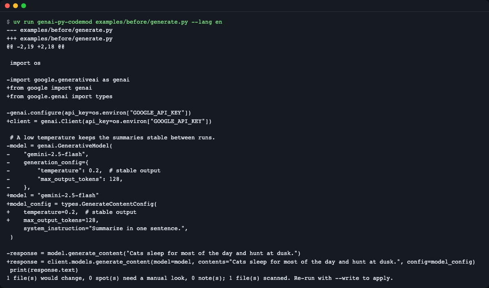
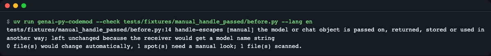
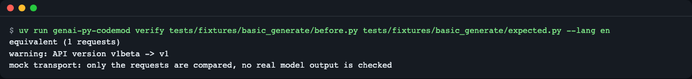
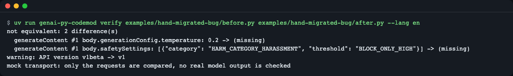
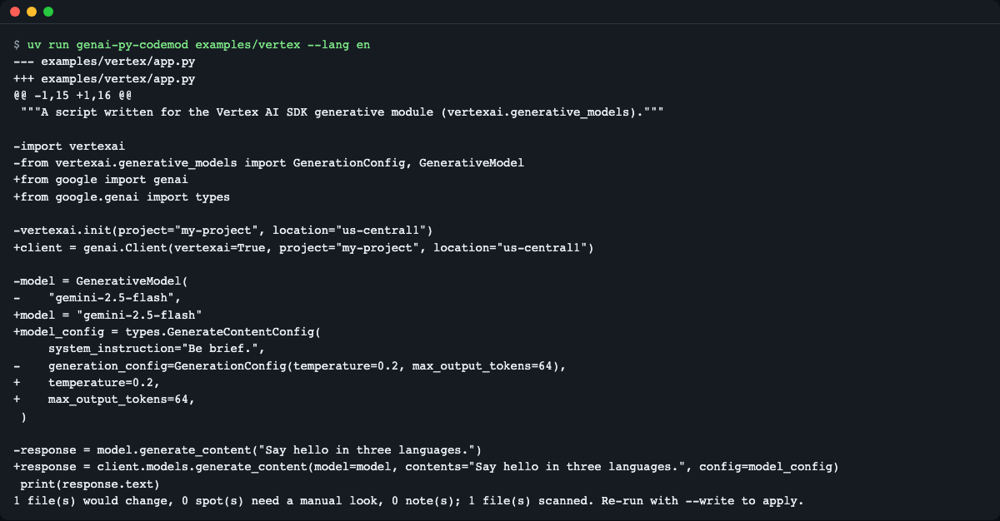
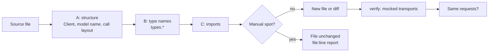

# genai-py-codemod

**English** | [한국어](README.ko.md)

A codemod that moves Python code written for `google-generativeai` or `vertexai.generative_models` to the `google-genai` SDK, keeping comments and formatting (it edits the syntax tree with [libcst](https://github.com/Instagram/LibCST)). It also lists the spots it refused to touch, and its `verify` command checks that the old and the new script send the same API requests, with no API key and no network.


*A dry run on `examples/before/generate.py`: the diff shows `genai.configure` and `GenerativeModel` becoming `genai.Client` and `generate_content(model=..., config=...)`, with the `# stable output` comment kept.*

## Who this is for

- You maintain scripts or services that still `import google.generativeai as genai`. That package's support ended on 2025-11-30 (see [the migration guide](https://ai.google.dev/gemini-api/docs/migrate)).
- You use `vertexai.generative_models` (`GenerativeModel`, `GenerationConfig`) and need the Vertex mode of `google-genai`.
- You want a reviewable diff first, a list of what needs a human, and some evidence that a migrated file still sends the same requests.

## Install

You need Python 3.11 or newer. The package is `genai-py-codemod` on PyPI (published with the first release). On a minimal Linux image you also need `curl`, and `git` for the clone route.

**Use it on your own project** (migration only, needs just `libcst`):

```bash
curl -LsSf https://astral.sh/uv/install.sh | sh   # installs uv (gives you uvx)
uvx genai-py-codemod src/                          # prints a diff, changes nothing
# or: pipx install genai-py-codemod   /   pip install genai-py-codemod
```

**Also use `verify`** (it runs your files against both SDKs, so both must be installed in the interpreter that runs it):

```bash
uvx --from 'genai-py-codemod[verify]' genai-py-codemod verify old/app.py src/app.py
# or: pip install 'genai-py-codemod[verify]'
# or: keep the tool where it is and pass --old-python / --new-python (interpreters that have the SDKs)
```

The `[verify]` extra installs `google-generativeai` and `google-genai`. Without it, `verify` stops with `ModuleNotFoundError: No module named 'requests'` and then prints which package to install.

**Try the bundled examples** (clone the repo):

```bash
git clone https://github.com/LeeGyeongPil/genai-py-codemod
cd genai-py-codemod
uv sync
uv run genai-py-codemod --version
```

```text
genai-py-codemod 0.1.0
```

`uv sync` also installs `google-generativeai` and `google-genai` into the project environment, which `verify` uses. The commands below use `uv run genai-py-codemod` from this clone.

## Quick start

Run it on the bundled examples. By default it only prints a diff and changes nothing.

```bash
uv run genai-py-codemod examples/before/generate.py --lang en
```

```diff
--- examples/before/generate.py
+++ examples/before/generate.py
@@ -2,19 +2,18 @@
 
 import os
 
-import google.generativeai as genai
+from google import genai
+from google.genai import types
 
-genai.configure(api_key=os.environ["GOOGLE_API_KEY"])
+client = genai.Client(api_key=os.environ["GOOGLE_API_KEY"])
 
 # A low temperature keeps the summaries stable between runs.
-model = genai.GenerativeModel(
-    "gemini-2.5-flash",
-    generation_config={
-        "temperature": 0.2,  # stable output
-        "max_output_tokens": 128,
-    },
+model = "gemini-2.5-flash"
+model_config = types.GenerateContentConfig(
+    temperature=0.2,  # stable output
+    max_output_tokens=128,
     system_instruction="Summarize in one sentence.",
 )
 
-response = model.generate_content("Cats sleep for most of the day and hunt at dusk.")
+response = client.models.generate_content(model=model, contents="Cats sleep for most of the day and hunt at dusk.", config=model_config)
 print(response.text)
1 file(s) would change, 0 spot(s) need a manual look, 0 note(s); 1 file(s) scanned. Re-run with --write to apply.
```

How to read it: lines starting with `-` are removed, `+` are added. The last line is the summary. In the new SDK there is no model object, so the model becomes a name string and its settings become one `types.GenerateContentConfig` that every call receives.

Apply the change with `--write`. Try it on a copy first:

```bash
mkdir -p /tmp/try && cp examples/before/generate.py /tmp/try/
uv run genai-py-codemod /tmp/try --write --lang en
uv run genai-py-codemod /tmp/try --lang en
```

The second run reports `0 file(s) would change`: the result is stable.

## Usage

| Command or option | What it does | Example |
|---|---|---|
| `PATH...` | Prints the diff for files or directories (`*.py`, recursive). Writes nothing. | `genai-py-codemod src/` |
| `--write` | Writes the migrated files. | `genai-py-codemod src/ --write` |
| `--check` | No diff. Exit code 1 if a file would change or a manual spot remains (for CI). | `genai-py-codemod --check src/` |
| `--report json` | Machine-readable report: summary, per-file findings with line, column, code, severity. | `genai-py-codemod src/ --report json` |
| `--api-version auto\|keep\|none` | `auto` pins `v1beta` only for `-latest`/`-preview`/`-exp` models, `keep` always pins the old SDK's version, `none` never pins. | `--api-version keep` |
| `--lang en\|ko` | Language of messages. | `--lang ko` |
| `verify BEFORE AFTER` | Runs both files against mocked transports and compares the API requests. Exit 0 = same, 1 = different, 2 = could not run or nothing to compare. | see below |

### Scenario 1: a spot the tool will not guess

```bash
uv run genai-py-codemod --check tests/fixtures/manual_handle_passed/before.py --lang en
```

```text
tests/fixtures/manual_handle_passed/before.py:14 handle-escapes [manual] the model or chat object is passed on, returned, stored or used in another way; left unchanged because the receiver would get a model name string
0 file(s) would change automatically, 1 spot(s) need a manual look; 1 file(s) scanned.
```

(exit code 1). The file passes its model into a function (`ask(model, "Hi")`). After migration `model` is only a string, so the function would break. The rule is: **a file is migrated completely or not at all.** If one spot is manual, the whole file stays unchanged and you get `file:line`, a reason code and a message. Notes with severity `info` (for example "the response shape changed") do not block a migration.


*The report for the file that passes the model object around: the original file is untouched, the spot is listed with its line.*

### Scenario 2: prove the migrated file sends the same requests

```bash
uv run genai-py-codemod verify tests/fixtures/basic_generate/before.py tests/fixtures/basic_generate/expected.py --lang en
```

```text
equivalent (1 requests)
warning: API version v1beta -> v1
mock transport: only the requests are compared, no real model output is checked
```

`verify` runs each script with the real SDK request-building code but a fake transport, so it sees the exact HTTP request each SDK would send. Network attempts are blocked and counted. It then compares the two lists of requests after normalizing known harmless differences. The API version change is a warning (use `--strict-version` to fail on it).

A script that sends no request at all (for example a module that only defines functions) is not "equivalent", because nothing was compared. `verify` says so and exits with 2:

```text
nothing to compare: neither file sent an API request. Pass entry-point scripts that run to the end and call the API (a module that only defines functions sends nothing); add a small call at the bottom, or verify a script that uses it.
mock transport: only the requests are compared, no real model output is checked
```


*Same requests: exit code 0.*

### Scenario 3: catch a hand-made migration that dropped settings

`examples/hand-migrated-bug/` holds a script and a hand migration of it that looks right but forgot two settings.

```bash
uv run genai-py-codemod verify examples/hand-migrated-bug/before.py examples/hand-migrated-bug/after.py --lang en
```

```text
not equivalent: 2 difference(s)
  generateContent #1 body.generationConfig.temperature: 0.2 -> (missing)
  generateContent #1 body.safetySettings: [{"category": "HARM_CATEGORY_HARASSMENT", "threshold": "BLOCK_ONLY_HIGH"}] -> (missing)
warning: API version v1beta -> v1
mock transport: only the requests are compared, no real model output is checked
```

(exit code 1). Each line is `request, path in the JSON body: old value -> new value`.


*The temperature and the safety setting are missing from the new request.*

### Scenario 4: Vertex AI code

```bash
uv run genai-py-codemod examples/vertex --lang en
```

`vertexai.init(project=..., location=...)` becomes `genai.Client(vertexai=True, project=..., location=...)`, and `GenerationConfig(...)` is merged into `types.GenerateContentConfig(...)`.


*Vertex AI code migrated to `genai.Client(vertexai=True, ...)`.*

Checking Vertex code needs the old Vertex SDK, which pins `google-genai<3`, so it lives in a second environment. Create it and point `verify` at it:

```bash
uv run python scripts/make_vertex_env.py
uv run genai-py-codemod verify tests/fixtures/vertex_basic/before.py tests/fixtures/vertex_basic/expected.py --old-python .venv-vertex/bin/python --lang en
```

```text
equivalent (1 requests)
warning: API version v1 -> v1beta1
mock transport: only the requests are compared, no real model output is checked
```

### From Python

```python
from genai_py_codemod import migrate_source, verify_files

result = migrate_source(open("app.py").read(), path="app.py")
print(result.code)       # migrated source, or the unchanged input if a manual spot exists
print(result.findings)   # spots with severity "manual" or "info"

check = verify_files("old/app.py", "src/app.py")   # old_python=..., new_python=... for two environments
print(check.equivalent)      # True only if both sent requests and all of them match
print(check.diffs)           # one entry per difference (request, JSON path, old value, new value)
print(check.nothing_compared)  # True if neither file sent a request
```

`verify_files` raises `VerifyRunError` when a file cannot be run (crash, timeout, SDK missing). Its `code` is one of `missing-file`, `interpreter-not-found`, `timeout`, `no-result`, `script-exit`, `script-failed`, `sdk-missing`, `network-blocked`, and `str(error)` / `error.message()` give the English sentence. `check.version_changes` lists API version changes as pairs, for example `[('v1beta', 'v1')]`; `check.warnings` has the same as English text (`'API version v1beta -> v1'`).

With `verify --json`, a run that cannot finish prints `{"equivalent": null, "error": "<code>", "message": "<sentence in the chosen language>"}` and exits 2, for example `{"equivalent": null, "error": "missing-file", "message": "/nonexist.py does not exist; pass the path of a Python file"}`. A successful run also includes `"version_changes": [{"before": "v1beta", "after": "v1"}]`.

## What gets migrated

The rules below are what the tool rewrites when it can follow the code safely. They apply to `google.generativeai` (Developer API) and, where marked, to `vertexai.generative_models` (Vertex AI).

| Old code | New code |
|---|---|
| `import google.generativeai as genai` | `from google import genai` (+ `from google.genai import types` when needed) |
| `genai.configure(api_key=K)` | `client = genai.Client(api_key=K)` |
| `vertexai.init(project=P, location=L)` (Vertex) | `client = genai.Client(vertexai=True, project=P, location=L)` |
| `m = genai.GenerativeModel("name", generation_config=..., safety_settings=..., system_instruction=..., tools=...)` | `m = "name"` and `m_config = types.GenerateContentConfig(...)` |
| `generation_config={...}` / `GenerationConfig(...)` (both SDKs) | fields of `types.GenerateContentConfig(...)` |
| `{HarmCategory.X: HarmBlockThreshold.Y}` safety dict | `safety_settings=[types.SafetySetting(category=..., threshold=...)]` |
| `m.generate_content(x)` | `client.models.generate_content(model=m, contents=x, config=m_config)` |
| `m.generate_content(x, stream=True)` | `client.models.generate_content_stream(...)` |
| `await m.generate_content_async(x)` | `await client.aio.models.generate_content(...)` (converted, not verified) |
| `m.start_chat(history=[...])`, `chat.send_message(x)` | `client.chats.create(model=m, config=m_config, history=[...])`; `stream=True` becomes `send_message_stream` |
| `m.count_tokens(x)` (model without system instruction or tools) | `client.models.count_tokens(model=m, contents=x)` |
| `genai.embed_content(model=..., content=...)` | `client.models.embed_content(...)`, `task_type` upper-cased; the result is read as `.embeddings[i].values` (reported as `info`) |
| `tools="code_execution"` | `tools=[types.Tool(code_execution=types.ToolCodeExecution())]` |
| `tools="google_search_retrieval"` | `types.GoogleSearchRetrieval` (keeps the request identical; `"google_search"` becomes `types.GoogleSearch`) |

Comments, blank lines, quotes and multi-line layout are kept. Running the tool again on its own output changes nothing.

## What is left for you

When the tool cannot follow something safely it lists the spot as `file:line code [severity] message` and **leaves the whole file unchanged**. These are the codes (also the `code` field in the JSON report):

| Code | Severity | Why | What to do |
|---|---|---|---|
| `handle-escapes` | manual | the model or chat object is passed on, returned or stored | pass the model name string instead, then run again |
| `handle-reassigned` | manual | the variable is assigned more than once | use one variable per model |
| `handle-untracked` | manual | the model object is not stored in a plain variable or used right away | assign it to a variable first |
| `call-kwargs` | manual | `*args` or `**kwargs` are passed | write the arguments out |
| `call-args` | manual | an argument has no equivalent in `google-genai` | check the argument in the [guide](https://ai.google.dev/gemini-api/docs/migrate) and move it by hand |
| `call-config-merge` | manual | generation settings are given on both the model and the call | merge them into one dict |
| `config-dynamic` | manual | the config is not a literal dict or `GenerationConfig(...)` | build it inline |
| `callable-tools-afc` | manual | `tools` holds Python functions; the new SDK calls them automatically by default | decide `automatic_function_calling` yourself |
| `tools-unsupported` | manual | a tool that is not converted | migrate it by hand |
| `tool-config` | manual | `tool_config` has no automatic conversion | migrate it by hand |
| `count-tokens-semantics` | manual | `count_tokens` on a model with a system instruction or tools counts differently | decide what you want to count |
| `async-chat` | manual | `send_message_async` | use `client.aio.chats` |
| `history-format` | manual | chat history is not a literal list of dicts; the new SDK needs `{"text": ...}` parts | fix the history format |
| `files-api`, `caches-api`, `tuning-api`, `unsupported-api` | manual | APIs with no automatic conversion (the whole file is held back) | migrate those calls by hand |
| `configure-args` | manual | `configure()` / `vertexai.init()` has arguments `Client` does not take over | move them by hand |
| `configure-scope` | manual | it is not one top-level statement | move it to the top level |
| `mixed-sdk` | manual | the file uses both the Developer API and the Vertex AI SDK | split the file |
| `import-scope` | manual | an old import is not at the top level | move the import to the top |
| `legacy-api` | manual | an old-SDK call is still left after the conversion | migrate that call by hand |
| `response-shape` | info | converted, but the response changed (for example embeddings) | update the code that reads the response |
| `dynamic-model` | info | the model name is not a string literal; moved as is | check it is a valid `google-genai` model name |

`info` notes never block a migration.

## API version

`google-generativeai` talks to `v1beta` (Developer API) or `v1` (Vertex); `google-genai` 3.x has its own default, so the same call can reach a different version. `--api-version auto` (default) adds `http_options=types.HttpOptions(api_version="v1beta")` only for `-latest`, `-preview`, `-exp` models and files that use caches. `keep` always pins the old SDK's version, `none` never pins. `verify` reports a version change as a warning (`warning: API version v1beta -> v1`); `--strict-version` turns it into a failure.

## Use in CI

```bash
genai-py-codemod --check src/
```

`--check` prints only the spots and a summary, never a diff:

```text
tests/fixtures/manual_handle_passed/before.py:14 handle-escapes [manual] the model or chat object is passed on, returned, stored or used in another way; left unchanged because the receiver would get a model name string
0 file(s) would change automatically, 1 spot(s) need a manual look; 1 file(s) scanned.
```

For a machine-readable report use `--report json`:

```bash
uv run genai-py-codemod tests/fixtures/manual_handle_passed/before.py --report json --lang en
```

```json
{
  "version": 1,
  "mode": "dry-run",
  "summary": {
    "files": 1,
    "changed": 0,
    "manual": 1,
    "info": 0,
    "errors": 0
  },
  "files": [
    {
      "path": "tests/fixtures/manual_handle_passed/before.py",
      "changed": false,
      "findings": [
        {
          "line": 14,
          "column": 10,
          "code": "handle-escapes",
          "severity": "manual",
          "message": "the model or chat object is passed on, returned, stored or used in another way; left unchanged because the receiver would get a model name string"
        }
      ]
    }
  ]
}
```

Keys and codes are the same in every language; only `message` is translated.

Exit codes:

| Command | 0 | 1 | 2 |
|---|---|---|---|
| `genai-py-codemod PATH...` (diff or `--write`) | done | - | a file could not be read, parsed or written; no Python files found; `--write` with `--check` |
| `genai-py-codemod --check PATH...` | nothing to change, no manual spot | a file would change or a manual spot remains | same as above |
| `genai-py-codemod verify BEFORE AFTER` | same requests | different requests | a file could not be run, or neither file sent a request (`nothing_compared`) |

A GitHub Actions step is enough: `pip install genai-py-codemod` then `genai-py-codemod --check src/`.

## Configuration

No API key is needed: migration is static analysis and `verify` uses mocked transports. Both environment variables are optional (see `.env.example`).

| Variable | Meaning |
|---|---|
| `GENAI_PY_CODEMOD_LANG` | Message language `en` or `ko`. Order: `--lang` > this variable > `LC_ALL`/`LC_MESSAGES`/`LANG` (starts with `ko` gives Korean, otherwise English). |
| `GENAI_PY_CODEMOD_VERTEX_PYTHON` | Interpreter with the old Vertex SDK; only the cross-interpreter Vertex tests read it, and they are skipped when it is unset. |

Code, JSON keys and the diff body are never translated.

**Language.** Messages, `--help` and argument errors come in English and Korean. Pick one with `--lang en|ko` (for example `genai-py-codemod --check src/ --lang ko`), or set `GENAI_PY_CODEMOD_LANG`; otherwise `LANG` decides (`ko...` gives Korean, anything else English). The README screenshots exist in both languages.

The "mock mode" here is the `verify` transport: it checks requests only. It does not call a model, so it cannot tell you the model's answers or your response-handling code are right.

## How it works



- Three passes, each parses the code again: A rewrites structure (`configure`/`vertexai.init` to `Client`, model handles to a name plus a config variable, calls to `client.models...`), B renames types (`HarmCategory`, `GenerationConfig` to `types.*`), C fixes imports. Small passes make formatting bugs easy to pin down.
- Formatting is not free in libcst: new nodes get default spacing and a trailing comment disappears when a node is rebuilt. The code reuses the original call's spacing and commas, so comments such as `# stable output` survive. Golden fixtures compare the output byte for byte.
- If a model object escapes (passed, returned, stored), uses `**kwargs`, files, caches, tuning and similar, the whole file is left alone and reported.
- `verify` runs the old script on the old SDK (gRPC forced to REST) and the new script on the new SDK, both with a mocked transport, then compares the request bodies.

## When to use it

- Good fit: scripts and small to mid-size services that call `generate_content`, chats, `count_tokens`, `embed_content` with plain arguments, and you want a diff, a list of leftovers and evidence before merging.
- Look elsewhere for the parts the report flags (Live, Imagen, files, caches, tuning, callable tools): migrate those by hand with the official [migration guide](https://ai.google.dev/gemini-api/docs/migrate) and the [`google-genai` SDK](https://github.com/googleapis/python-genai) docs.

## Alternatives

Other ways to do the same job. This is what each one does as of 2026-11-19; check their pages for the current state.

- **obelize** ([repo](https://github.com/hakanbogan/obelize), PyPI `obelize` 0.10.0) is a general migration tool with several "packs" (numpy, openai and others), one of which moves `google-generativeai` to `google-genai`. It also runs your own tests before and after to check the result and has `--apply` and `undo`. Choose it if you already use it for other migrations. In the version checked, `vertexai.generative_models` was not converted, tools were flagged rather than converted, and the check depends on your tests, not on comparing request bodies. This project differs by converting the Vertex SDK, comparing the actual API requests without any tests of yours, converting the `code_execution` and `google_search_retrieval` tool strings, handling the API version change, and having one runtime dependency (`libcst`).
- **The `gemini-api-dev` skill** in Google's [gemini-skills](https://github.com/google-gemini/gemini-skills) repository lets a coding agent do the migration by hand. It handles code this tool refuses, but a model edits the code, so the result is not deterministic and there is no report or CI exit code.
- **The official [migration guide](https://ai.google.dev/gemini-api/docs/migrate)** lists the before/after calls for manual work. This tool applies those mappings as rules.

## Limits

- `verify` proves the same **requests** only. It does not check model output or your code that reads the response (`response.candidates[...]` and embedding results changed shape; the tool reports these as `info`).
- The files you verify run like scripts, to the end. Use small entry files. Calling one function of a module (`--call`) is planned for a later version.
- Async calls (`generate_content_async`) are converted but not verified. A second `send_message` after a streamed chat can build a different history in the two SDKs. Function declarations, callable tools, files, caches, tuning, Imagen and Live are only reported.
- A module that only defines functions sends no request, so `verify` cannot prove anything about it (exit 2). Give it a script that runs to the end and calls the API.
- Code that sends requests in an order that changes between runs (parallel code) can give false differences.
- `tools="google_search_retrieval"` becomes `types.GoogleSearchRetrieval` so the request stays identical. Newer models prefer `google_search`.

## Troubleshooting

| Symptom | Cause | Fix |
|---|---|---|
| A file stays unchanged and `[manual]` spots are listed | A manual spot exists, so the whole file is skipped | Fix the listed `file:line` by hand (or refactor it), run again |
| `verify` cannot run the script | The script crashed, timed out or needs input in the mocked run | Make the script run end to end with plain arguments, raise `--timeout` |
| `verify` says "API version v1beta -> v1" | `google-genai` 3.x defaults to a different API version | Expected warning; `--api-version keep` when migrating, or `--strict-version` to fail |
| Vertex `verify` cannot find the old SDK | Old Vertex SDK is not in the current environment | `uv run python scripts/make_vertex_env.py`, then pass `--old-python .venv-vertex/bin/python` |
| `verify`: `No module named 'requests'` or another missing SDK | The interpreter running the file lacks the old or new SDK | `pip install 'genai-py-codemod[verify]'`, or pass `--old-python` / `--new-python` |
| `verify` exits 2 with "nothing to compare" | Neither file sent an API request | Verify a script that runs to the end and calls the API |
| Output is in Korean | Your `LANG` starts with `ko` | `--lang en` or `GENAI_PY_CODEMOD_LANG=en` |

## Development

```bash
uv run pytest -q
```

Without `GENAI_PY_CODEMOD_VERTEX_PYTHON`, 10 cross-interpreter Vertex tests are skipped. Bugs and ideas are welcome as issues. Changes are listed in [CHANGELOG.md](CHANGELOG.md).

## License

MIT. Gemini and Vertex AI are Google products. This project is not affiliated with Google.
